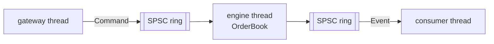

# Limit Order Book Matching Engine

[](https://github.com/pavanprudhvi02/limit-order-book/actions/workflows/ci.yml)

A price-time priority matching engine for a single instrument, in C++20. It supports limit, market, immediate-or-cancel and fill-or-kill orders, plus cancel and modify. Orders come from a pre-allocated memory pool, and the engine runs on its own thread, fed and drained through lock-free single-producer/single-consumer ring buffers.

Originally built for my Spring 2025 coursework at the University of Florida; this repository is a clean rebuild.

**Stack:** C++20, CMake, GoogleTest, Valgrind (memcheck, Cachegrind), AddressSanitizer, ThreadSanitizer

## How it works



**The book** (`include/lob/order_book.h`, `src/order_book.cc`)

- Bids are a `std::map<Price, PriceLevel, std::greater<>>` and asks a `std::map<Price, PriceLevel, std::less<>>`, so the best price on each side is always `begin()`.
- Each `PriceLevel` is a FIFO queue of orders linked intrusively (the `prev`/`next` pointers live inside `Order`). Adding at the back and cancelling from the middle are both O(1) with no extra allocation.
- An `std::unordered_map<OrderId, Order*>`, reserved up front, finds any order in O(1) for cancel and modify.
- Prices are integer ticks, never floating point.

**Matching rules**

- An incoming order walks the opposite side from the best price while prices cross. At each level the oldest order fills first, and every trade prints at the resting order's price.
- **Limit** orders rest any remainder. **Market** orders take whatever is available and never rest. **IOC** fills what it can at its limit and cancels the rest. **FOK** checks available quantity first and either fills completely or is rejected without touching the book.
- **Modify:** shrinking an order at the same price keeps its place in the queue. A new price or a larger size is a cancel-and-replace that goes to the back, and it can trade immediately if the new price crosses.

**Memory pool** (`include/lob/memory_pool.h`)

- All `Order` storage is allocated once at startup. `Allocate`/`Free` push and pop an intrusive free list, so the matching path never calls `malloc`.
- When the pool is full, any part of an order that already traded stands, and only the remainder is rejected.

**SPSC ring** (`include/lob/spsc_ring.h`)

- A power-of-two ring with acquire/release atomics and no read-modify-write instructions.
- The producer and consumer indices sit on separate cache lines, so the two threads don't keep invalidating each other's line. Each side also caches the other side's index and only reloads it when the ring looks full or empty.
- The engine thread busy-polls the input ring, trading a core for latency.

## Build and run

```bash
cmake -S . -B build -DCMAKE_BUILD_TYPE=Release
cmake --build build -j

build/lob_replay data/sample_orders.csv   # step through matching on a small scenario
build/lob_bench --ops 1000000             # book throughput/latency and threaded pipeline latency
ctest --test-dir build --output-on-failure
```

`lob_replay` prints every event and the final depth:

```
> N,6,BUY,LIMIT,10100,65
  TRADE   50 @ 10100  (aggressor 6 BUY, resting 1)
  TRADE   15 @ 10100  (aggressor 6 BUY, resting 2)
...
> N,8,BUY,FOK,10200,100
  REJECT  order 8: fill-or-kill not fillable
> N,9,BUY,IOC,10100,30
  TRADE   15 @ 10100  (aggressor 9 BUY, resting 2)
  CANCEL  order 9 (15 unfilled)
```

`lob_bench` replays a deterministic synthetic flow: a random-walk mid price, with about 60% limit orders, 25% cancels, 8% market orders and the rest modifies.

- **book:** times each call into the book on one thread.
- **pipeline:** measures from the moment a command is pushed to the moment each of its events is popped on another thread, with the producer paced (`--rate`). `--rate 0` floods the pipeline to measure throughput.

Results depend heavily on the machine, so CI prints them in the job summary rather than this README quoting numbers. Pin threads to dedicated cores for stable measurements.

## Testing

| Test | What it checks |
|---|---|
| `order_book_test` | Price-time priority, trades at the resting price, multi-level sweeps, market/IOC/FOK behaviour, cancel from the middle of a queue, modify keeping or losing priority, rejects, pool exhaustion |
| `reference_test` | **Differential test:** five seeds × 30,000 random operations (including IOC and FOK) run against a deliberately naive reference matcher. Every trade, cancel and reject must match exactly, the final depth must be identical, and the book's internal invariants are checked throughout |
| `primitives_test` | Memory pool reuse and alignment; ring buffer FIFO, wrap-around and full/empty behaviour; 2 million items across two threads arriving complete and in order |
| `engine_test` | 200,000 commands through producer → engine → consumer threads produce exactly the same events as calling the book directly |

`OrderBook::CheckInvariants()` walks the whole book and verifies:

- sides are sorted and the book is never crossed at rest
- level totals and order counts match
- queues are in arrival order
- the id index agrees with the queues
- every order lives in the pool

CI also runs:

- the tests under **AddressSanitizer + UBSan** and under **ThreadSanitizer**
- the core tests under **Valgrind memcheck** (fails on any invalid access or leak)
- a **Cachegrind** profile of the book, with miss rates and the hottest functions posted to the job summary

To profile locally:

```bash
valgrind --tool=cachegrind --cache-sim=yes build/lob_bench --ops 200000 --skip-pipeline
cg_annotate cachegrind.out.<pid> | less
```

## Layout

```
include/lob/   order book, memory pool, SPSC ring, engine, synthetic order flow
src/           book and engine implementation
tests/         GoogleTest suites, including the reference matcher
bench/         lob_bench
tools/         lob_replay
data/          sample order file
```

## What I would add next

- A flat array of price levels indexed by tick for instruments with a narrow price band, to avoid tree walks
- Self-trade prevention and stop orders
- A binary market-data feed of book updates

## License

MIT
